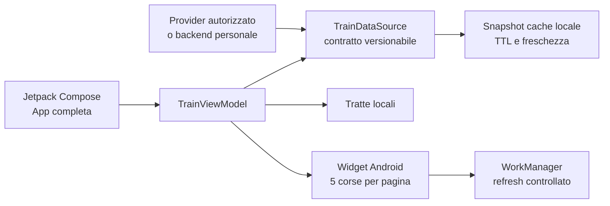

# Binario — app, widget e companion smartwatch

**Binario** è un’app Android originale per seguire le proprie tratte ferroviarie in tutta Italia. La home è un pianificatore di viaggio con modalità **Viaggio**, **Treno** e **Stazione**, partenza, arrivo, inversione, opzione andata/ritorno, data e ora selezionabili, filtri, ricerche recenti e preferite. Le soluzioni e il tabellone della tratta attiva sono superfici successive nella sezione Consulta; il widget home è un tabellone ridimensionabile, configurabile per istanza. È possibile salvare tratte e monitorare localmente un numero treno; alert reali restano disabilitati senza fonte autorizzata. L’app espone operatore, categoria, orari, ritardi, binari e fermate. La tratta dimostrativa iniziale è **Roma Termini – Torino Porta Nuova** e le corse sono ordinate in modo neutrale per orario previsto.

> **Stato dei dati:** la versione 0.16.1 include un catalogo dimostrativo locale multi-operatore. L’interfaccia, la cache, l’app e il widget sono funzionanti, ma gli orari e i ritardi non sono ancora live. L’app lo dichiara esplicitamente con l’etichetta **“catalogo dimostrativo locale — non live”**. Per uso ferroviario reale, configurare un provider documentato e autorizzato dietro `TrainDataSource` o un gateway personale.

## Funzionalità

| Area | Comportamento |
|---|---|
| Tratte personali | Crea, salva, seleziona, fissa e rimuove tratte origine–destinazione; le tratte fissate rimangono locali e precedono le altre. |
| Partenze rapide | Mostra le due corse più utili della tratta attiva, con operatore, categoria, orario previsto, stato e binario; un tocco apre il dettaglio. |
| Andata/ritorno | Alterna la direzione con un comando esplicito nell’app e nel widget. |
| Corse nell’app | Mostra l’intero elenco delle prossime corse della direzione selezionata con operatore e categoria. |
| Copertura e filtri | Modello nazionale multi-operatore per Trenitalia Regionale, Trenitalia, Frecce, Italo, Trenord e altri operatori; ricerca per numero e filtro operatore. |
| Ordinamento | Le corse sono ordinate per orario previsto e, a parità, per numero treno; nessun operatore o regione riceve priorità automatica. |
| Dettaglio corsa | Mostra operatore, categoria, orari programmati/previsti, ritardo, binario e tutte le fermate. |
| Sveglia fermata | Da una fermata futura pianifica una notifica locale cinque minuti prima dell’orario previsto; chiede il consenso notifiche solo al tocco e non invia dati a Binario. |
| Condivisione | Dal dettaglio corsa apre il foglio di condivisione di sistema Android con un testo completo; il formato `TrainShareContent` è indipendente da Android e riutilizzabile da un futuro iOS. |
| Refresh | Aggiorna manualmente l’elenco e conserva lo stato di freschezza del dato. |
| Data e ora | Il pianificatore apre selettori nativi Android per data e ora; le scelte restano nello stato della ricerca corrente. |
| Stazioni personali | Le stazioni possono essere aggiunte o rimosse dai preferiti in locale, senza account o sincronizzazione. |
| Stazioni vicine | Su azione esplicita e consenso a `ACCESS_COARSE_LOCATION`, ordina il catalogo locale per distanza in linea d’aria. La posizione non viene salvata né usata in background. |
| Dettatura viaggio | Avvia il riconoscitore vocale di sistema per compilare tratta, stazione, treno, data, ora e andata/ritorno; Binario non richiede il permesso microfono e interpreta solo il testo restituito. |
| Filtro cambi | Nella ricerca tratta permette di scegliere qualsiasi viaggio, diretto, massimo uno o massimo due cambi; il catalogo locale li presenta soltanto come dati dimostrativi. |
| Consulta | Riunisce tabellone Treni e Stazioni in una sola destinazione, con due schede squadrate, descrittive e accessibili. |
| Impostazioni | Raccoglie tema, tratte personali, monitoraggi, integrazioni e informative privacy. |
| Widget Android | Tabellone originale ad alto contrasto, configurabile per ogni istanza come tratta, stazione o treno. Risponde al resize con densità compatta, standard ed espansa; il formato standard conserva 5 corse per pagina. Le frecce cambiano pagina, il comando centrale cambia direzione o apre la modifica e `↻` pianifica un refresh sicuro. Il giallo segnala variazioni soltanto da snapshot non dimostrativi. |
| Wear OS | Companion Android 11+/API 30+ con tratta attiva, massimo due corse, stato quality/freshness, refresh delegato al telefono, Tile e complication testuale. |
| Apple Watch | Companion nativo watchOS 10 ricostruito in `apple-watch/`: SwiftUI, cache-first, Widget/complication, App Intent e Watch Connectivity per una futura app iOS Binario. Richiede Xcode su macOS per generazione, firma e test. |
| Accessibilità | Tema chiaro/scuro, palette ad alto contrasto, font scalabile, testo esplicito degli stati, target ampi e semantica TalkBack. |
| Tema personale | Selettore persistente Sistema/Chiaro/Scuro nella barra superiore; la scelta resta locale al dispositivo. |
| Privacy | Nessun account, advertising o tracking. Tratte e cache restano locali; posizione approssimata e notifiche sono richieste soltanto su azione esplicita e non sono inviate a Binario. |

## Installazione

L’APK di debug è generato in:

```text
app/build/outputs/apk/debug/app-debug.apk
wear/build/outputs/apk/debug/wear-debug.apk
```

Richiede **Android 8.0 o successivo** (`minSdk 26`). Per installare il file su un dispositivo personale, Android può chiedere di autorizzare l’installazione dall’origine utilizzata. Aggiungi il widget dalla schermata home e scegli, per quella singola istanza, **tratta**, **stazione** oppure **treno**; il contenuto può essere modificato dalla testata del widget.

## Sviluppo e build

La toolchain verificata è OpenJDK 21 per la build, Java 17 come target, Android Gradle Plugin 8.13.0, Gradle 8.14.5 e Android SDK API 36.

```bash
./gradlew :app:testDebugUnitTest :wear:testDebugUnitTest :app:assembleDebug :wear:assembleDebug
```

Il comando deve completarsi senza errori. Il report HTML di lint viene prodotto in `app/build/reports/lint-results-debug.html`.

## Architettura



Il dominio dati è deliberatamente separato da Compose e dagli API Android. In futuro può essere estratto in un core Kotlin Multiplatform, mentre app Android/widget, Wear OS e l’app iOS/watchOS restano integrazioni native. Il Data Layer Wear OS trasporta solo un cache snapshot ridotto; non è una fonte live né un canale per credenziali o dati personali estesi.

## Esperienza unificata e integrazioni

L’app Android è il centro delle preferenze per widget, smartwatch Android, Apple Watch e comandi vocali. Da **Impostazioni → Integrazioni** si controlla quali superfici possono ricevere lo snapshot della tratta attiva e si vede lo stato del collegamento. Token Alexa, segreti OAuth e credenziali non vengono mai memorizzati nel client. Wear OS e Apple Watch sono companion cache-first; il Voice Bridge offre un profilo remoto opzionale, protetto e versionato. Android non invia ancora il profilo: il collegamento richiederà una sessione utente esplicita prima di abilitare qualsiasi rete.

## Provider live: regole vincolanti

Il catalogo `DemoTrainDataSource` va sostituito, non ampliato con endpoint non documentati. Il repository può delegare a `TrenitaliaViaggiaTrenoAdapter` soltanto tramite un gateway autorizzato; l’adapter non effettua richieste di rete senza tale canale. Un provider live deve rispettare questi requisiti:

1. Essere documentato e autorizzato per lo scenario d’uso.
2. Non inserire chiavi o credenziali nell’APK; usare un backend personale quando servono segreti.
3. Restituire provenienza, timestamp, TTL, stati di errore e schema versionato.
4. Applicare limiti di richiesta e cache per evitare refresh inutili.
5. Conservare la differenza tra orario programmato, previsto, ritardo, binario non disponibile e soppressione.

## Conformità per design

Il progetto contiene `BUILD_SPEC.md`, `SECURITY.md`, `AI_FEATURE_GATE.md` e `verification_summary.md`. Questi documenti fissano controlli per accessibilità, privacy, gestione vulnerabilità, AI gate, supply chain, release e futura distribuzione Google Play/App Store.

La build applica traffico HTTPS obbligatorio, cleartext disabilitato, trust store di sistema, backup/trasferimento esclusi, componenti non esportati e PendingIntent immutabili. I dettagli verificati sono riportati in `verification_summary.md`.

## Limiti attuali e prossimo passo

Il prodotto non include ancora provider live, avvisi di ritardo attivabili dall’utente, alert di discesa, tabelloni stazione o raccolta diagnostica. Il prossimo passo dati-dipendente è il modello `SavedMonitoring` per treni e stazioni, seguito da tabelloni e alert soltanto su feed autorizzati. I companion al polso sono informativi: non includono ticketing NFC, pagamento, posizione continua, account obbligatori o tracking.

Nessun codice, asset, marchio, testo, credenziale, endpoint o contratto delle app analizzate come riferimento è stato riutilizzato in Binario.
