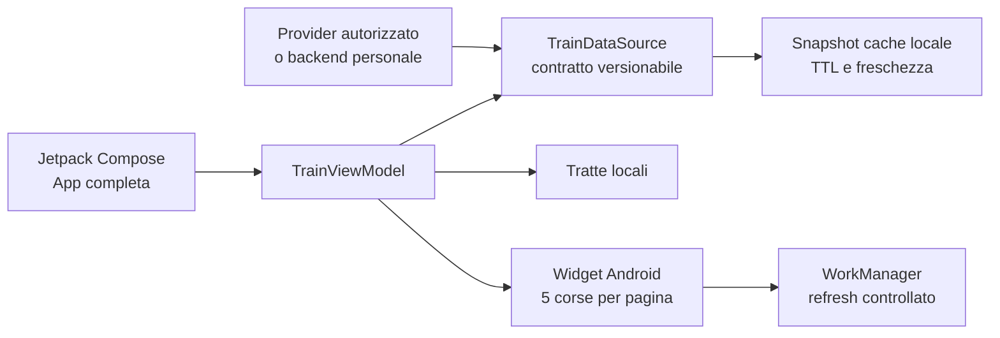

# Binario — app smartphone e companion

**Binario** è un’app per pendolari con superfici native Android e iPhone. La home **Oggi** mette in primo piano la tratta scelta, le prossime due corse, il ritorno e le tratte salvate. La sezione **Cerca** conserva il pianificatore Android con modalità **Viaggio**, **Treno** e **Stazione**, data e ora, andata/ritorno e filtri. Il tabellone completo resta in **Consulta**; l’agenda è raggiungibile dalla home. Il widget Android è configurabile per istanza. L’app espone ritardi, binari e stati di circolazione soltanto quando identità, provenienza e scadenza del dato lo consentono.

> **Stato dei dati:** la versione 0.20.0 privilegia canali realtime autorizzati e identificati, quindi usa orari GTFS ufficiali embedded solo come fallback programmato. Gli snapshot espongono provider, confidenza, freshness, punteggio qualità e warning. Se il realtime manca, non è identificabile con certezza o scade, l’app dichiara **“orario programmato”** o **“dati live non disponibili”** e non inventa ritardi, binari, soppressioni o posizioni.

## Funzionalità

| Area | Comportamento |
|---|---|
| Oggi | Tratta abituale, inversione della direzione, due prossime corse e scorciatoie locali. Nessuna tratta viene scelta arbitrariamente al primo avvio. Su iPhone la tratta abituale si seleziona fra quelle salvate. |
| Consultazione continua | Aggiornamento in primo piano: 60 secondi per dati operativi, 5 minuti per orari programmati, 2 minuti dopo un errore. Nessun nuovo timer in background; le ricerche Android per una data/ora scelta restano pianificate. |
| Tratte e ricerca | L’app si apre senza una tratta preimpostata. Cerca una qualunque coppia origine–destinazione senza salvarla; salvataggi, recenti e fissate sono scorciatoie locali facoltative. |
| Partenze rapide | Mostra le due corse più utili della tratta attiva, con operatore, categoria, orario previsto, stato e binario; un tocco apre il dettaglio. |
| Andata/ritorno | Alterna la direzione con un comando esplicito nell’app e nel widget. |
| Corse nell’app | Mostra l’intero elenco delle prossime corse della direzione selezionata con operatore e categoria. |
| Copertura e filtri | Modello nazionale multi-operatore per Trenitalia Regionale, Trenitalia, Frecce, Italo, Trenord e altri operatori; ricerca per numero e filtro operatore. |
| Ordinamento | Le corse sono ordinate per orario previsto e, a parità, per numero treno; nessun operatore o regione riceve priorità automatica. |
| Dettaglio corsa | Mostra operatore, categoria, orari programmati/previsti, ritardo, binario e tutte le fermate. |
| Sveglia fermata | Anticipo da 1 a 60 minuti, con scelte rapide 5/10/15/30. Reimpostare la stessa fermata aggiorna l’allarme. La sveglia usa l’orario mostrato alla conferma; chiede il consenso notifiche solo al tocco e non invia dati a Binario. |
| Condivisione | Dal dettaglio corsa apre il foglio di condivisione di sistema Android con un testo completo; il formato `TrainShareContent` è indipendente da Android e riutilizzabile da un futuro iOS. |
| Refresh | Aggiorna manualmente l’elenco e conserva lo stato di freschezza del dato. |
| Data e ora | Il pianificatore apre selettori nativi Android per data e ora; le scelte restano nello stato della ricerca corrente. |
| Stazioni personali | Le stazioni possono essere aggiunte o rimosse dai preferiti in locale, senza account o sincronizzazione. |
| Ricerca stazioni | Usa un’unica lista canonica: il database curato `stazioni_ferroviarie_curato_v4`, con 5.239 stazioni, alias, coordinate e codici ferroviari quando disponibili. La ricerca normalizza accenti, spazi e punteggiatura e trova anche gli alias. Una stazione digitata non presente resta una ricerca libera esplicita, senza creazione di orari fittizi. |
| Stazioni vicine | Su azione esplicita e consenso a `ACCESS_COARSE_LOCATION`, ordina il catalogo locale per distanza in linea d’aria. La posizione non viene salvata né usata in background. |
| Dettatura viaggio | Avvia il riconoscitore vocale di sistema per compilare tratta, stazione, treno, data, ora e andata/ritorno; Binario non richiede il permesso microfono e interpreta solo il testo restituito. |
| Filtro cambi | Nella ricerca tratta permette di scegliere qualsiasi viaggio, diretto, massimo uno o massimo due cambi; viene applicato solo se la fonte restituisce il dato, senza stime locali. |
| Consulta | Riunisce tabellone Treni e Stazioni in una sola destinazione, con due schede squadrate, descrittive e accessibili. |
| Impostazioni | Raccoglie tema, tratte personali, monitoraggi, integrazioni e informative privacy. |
| Widget Android | Tabellone originale ad alto contrasto, configurabile per istanza come qualunque tratta digitata, stazione o numero treno, con nome locale facoltativo. Non richiede una tratta o un monitoraggio salvato nell’app: ogni istanza conserva target, snapshot, direzione, pagina ed errore separatamente. Risponde al resize con densità compatta, standard ed espansa; il formato compatto mostra due righe complete sul layout stabile, il formato standard conserva 5 corse per pagina. Espone provider, confidenza, quality score, freshness e warning; il giallo segnala solo variazioni di snapshot operativi qualificabili, mai del fallback GTFS programmato. |
| Wear OS | Companion Android 11+/API 30+ con tratta attiva, massimo due corse, stato quality/freshness, refresh delegato al telefono, Tile e complication testuale. |
| Apple Watch | Companion nativo watchOS 10 ricostruito in `apple-watch/`: SwiftUI, cache-first, Widget/complication, App Intent e Watch Connectivity per una futura app iOS Binario. Richiede Xcode su macOS per generazione, firma e test. |
| Alexa | Companion server-side in `alexa-companion/` con Custom Skill, account linking e profilo vocale minimo. Non è una seconda app ferroviaria: usa soltanto dati sincronizzati dall'app principale o dallo stesso backend autorizzato e fallisce esplicitamente se lo snapshot è assente o scaduto. |
| Accessibilità | Tema chiaro/scuro, palette ad alto contrasto, font scalabile, testo esplicito degli stati, target ampi e semantica TalkBack. |
| Tema personale | Selettore persistente Sistema/Chiaro/Scuro nella barra superiore; la scelta resta locale al dispositivo. |
| Privacy | Nessun SDK pubblicitario o analytics è configurato nel codice. Tratte e cache restano locali; posizione approssimata e notifiche sono richieste soltanto su azione esplicita. Il backup automatico Android è escluso; l'esportazione JSON è manuale e scelta dall'utente. Leggi [PRIVACY.md](PRIVACY.md) per superfici, feed esterni, Wear, Companion Expo, Alexa, conservazione e limiti attuali. |

## Installazione

L’APK di debug è generato in:

```text
app/build/outputs/apk/debug/app-debug.apk
wear/build/outputs/apk/debug/wear-debug.apk
```

Richiede **Android 8.0 o successivo** (`minSdk 26`). Per installare il file su un dispositivo personale, Android può chiedere di autorizzare l’installazione dall’origine utilizzata. Aggiungi il widget dalla schermata home e scegli, per quella singola istanza, **tratta**, **stazione** oppure **treno**; il contenuto può essere modificato dalla testata del widget.

## Sviluppo e build

La toolchain verificata è OpenJDK 21 per la build, Java 17 come target, Android Gradle Plugin 8.13.0, Gradle 8.14.6 e Android SDK API 36.

```bash
./gradlew :app:testDebugUnitTest :wear:testDebugUnitTest :app:assembleDebug :wear:assembleDebug
```

Il comando deve completarsi senza errori. Il report HTML di lint viene prodotto in `app/build/reports/lint-results-debug.html`.

## Architettura



Il dominio dati è deliberatamente separato da Compose e dagli API Android. L'app Android per smartphone resta il prodotto principale e la fonte di verità; widget, Wear OS, Apple Watch e Alexa sono companion. In futuro il dominio può essere estratto in un core Kotlin Multiplatform, mentre le superfici restano integrazioni dedicate. Ogni companion riceve soltanto uno snapshot ridotto e versionato; non è una fonte live indipendente né un canale per credenziali o dati personali estesi.

## Esperienza unificata e integrazioni

L’app Android è il centro delle preferenze per widget, smartwatch Android, Apple Watch e comandi vocali. Da **Impostazioni → Integrazioni** si controlla quali superfici possono ricevere lo snapshot della tratta attiva e si vede lo stato del collegamento. Token Alexa, segreti OAuth e credenziali non vengono mai memorizzati nel client. Wear OS, Apple Watch e Alexa sono companion cache-first; `alexa-companion/` offre soltanto il profilo remoto e l'account linking necessari alla skill. Android non invia ancora il profilo: il collegamento richiederà una sessione utente esplicita prima di abilitare qualsiasi rete.

## Fonti realtime e fallback programmato

`BinarioDataGraph` è l’unico punto di composizione Android usato da app, widget e worker. Le corse programmate provengono dai quadri RFI (19 stazioni hub mappate) e da dieci data pack GTFS embedded. Gli adapter open data STA Alto Adige e SNCF ora possono arricchire le tratte dello **stesso feed statico**, soltanto con trip ID, giorno di servizio, fermata e orario d’origine verificati e osservazioni ancora valide. I feed estranei alla tratta non vengono interrogati; una corrispondenza assente o ambigua lascia l’orario programmato. Questa integrazione non garantisce copertura realtime nazionale. iPhone usa ancora il repository GTFS programmato; Alexa dichiara l’indisponibilità dei dati live.

**AMT Genova–Casella e Cotral/ASTRAL Ferro restano catalogati ma sono disabilitati e non sono inclusi nell’APK**, perché non soddisfacevano il gate di freschezza di 30 giorni. I tabelloni best-effort Italo, ViaggiaTreno e RFI restano un opt-in con `./gradlew -PBINARIO_PERSONAL_REALTIME_SOURCES=true` per build personali, non distribuibili. Gli avvisi RSS RFI e le posizioni veicolo non sono collegati alle schermate. I pack embedded hanno una validità temporale e oltre la scadenza l’app mostra un avviso. Il catalogo curato di 5.239 stazioni identifica le stazioni e non genera informazioni di circolazione. I canali protetti Svizzera GTFS-RT e Trenord E015 richiedono ancora un gateway e le relative autorizzazioni. Vedi [stato dell’implementazione pendolari](docs/COMMUTER_IMPLEMENTATION_2026-10-26.md), [catalogo stazioni](docs/data-sources/CURATED_STATION_CATALOG.md), [refresh GTFS](docs/data-sources/GTFS_PACK_REFRESH.md) e [accessi realtime](docs/data-sources/REALTIME_ACCESS_GAPS.md).

Un nuovo provider deve rispettare questi requisiti:

1. Essere documentato e autorizzato per lo scenario d’uso.
2. Non inserire chiavi o credenziali nell’APK; usare un backend personale quando servono segreti.
3. Restituire provenienza, timestamp, TTL, stati di errore e schema versionato.
4. Applicare limiti di richiesta e cache per evitare refresh inutili.
5. Conservare la differenza tra orario programmato, previsto, ritardo, binario non disponibile e soppressione.

## Conformità e stato di verifica

La build applica traffico HTTPS obbligatorio, cleartext disabilitato, trust store di sistema, backup/trasferimento esclusi, componenti non esportati e PendingIntent immutabili. Lo stato verificato del codice, i problemi aperti e il piano di risanamento sono documentati in [docs/audit-independent-2026-09-23.md](docs/audit-independent-2026-09-23.md), nel relativo [addendum](docs/audit-independent-2026-09-23-addendum.md) e in [docs/PIANO_STABILIZZAZIONE_v0.20.4.md](docs/PIANO_STABILIZZAZIONE_v0.20.4.md). L'inventario privacy verificabile e i limiti che bloccano una pubblicazione sono in [PRIVACY.md](PRIVACY.md). Le funzioni Wear OS, Apple Watch, sincronizzazione companion e comandi vocali sono da considerare sperimentali finché i relativi gate del piano non risultano superati.

## Limiti attuali e prossimo passo

Le coperture realtime sono best-effort e dipendono da fonte, identità della corsa, freshness e completezza; il matching definitivo dei Trip Updates SNCF alla UI richiede una relazione verificata fra trip ID realtime e GTFS statico. Svizzera GTFS-RT richiede token gateway e Trenord realtime richiede E015. I companion al polso restano informativi e non includono ticketing NFC, pagamento, posizione continua, account obbligatori o tracking.

Nessun codice, asset, marchio, testo, credenziale, endpoint o contratto delle app analizzate come riferimento è stato riutilizzato in Binario.
