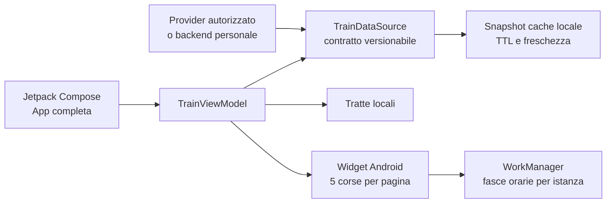

# Binario — app smartphone e companion

## Binario 2.0 — UI/UX

Il design system verde accessibile è documentato in [design/BINARIO_2_DESIGN_SYSTEM.md](design/BINARIO_2_DESIGN_SYSTEM.md), con la [specifica Echo Show](alexa-companion/docs/ECHO_SHOW_APL_UI_SPEC.md) e il [prototipo offline per i display Echo](design/binario-echo-preview.html), i cui orari sono fittizi. I token sono applicati a Wear OS (tema Material 3 for Wear, Tile), Apple Watch e iPhone (cataloghi asset con tinta globale) e alla dashboard del companion Alexa; le schermate Echo Show (APL) sono implementate nella skill ma compaiono solo dopo che il titolare abilita l’interfaccia APL ([istruzioni](alexa-companion/docs/ALEXA_SETUP.md#schermate-echo-show-apl--azione-del-titolare)) e non sono ancora state verificate su un dispositivo. Sull’app Android sono applicate le fasi 1–3: palette e testata del planner, navigazione **Pianifica / Partenze / Per te** con card della prossima partenza e dettaglio a timeline, barra laterale e doppio pannello su tablet e pieghevoli; non sono ancora state verificate su dispositivi reali. Nessun provider live, ordine delle fonti dati o supporto Android Auto cambia con questo lavoro.

**Binario** è un’app Android originale per seguire le proprie tratte ferroviarie in tutta Italia. La home è un pianificatore di viaggio con modalità **Viaggio**, **Treno** e **Stazione**, partenza, arrivo, inversione, opzione andata/ritorno, data e ora selezionabili, filtri, ricerche recenti e preferite. La navigazione ha tre destinazioni: **Pianifica** (ricerca e soluzioni), **Partenze** (tabellone della tratta attiva e tabelloni di stazione) e **Per te** (tratte salvate, Agenda, preferiti, viaggi, sveglie, preferenze e privacy); da 600 dp diventa una barra laterale e da 840 dp elenco e dettaglio stanno affiancati; il widget home è un tabellone ridimensionabile, configurabile per istanza. È possibile salvare tratte e monitorare localmente un numero treno. L’app espone operatore, categoria, orari, ritardi, binari e fermate soltanto quando la fonte e la qualità dello snapshot lo consentono.

> **Stato dei dati:** la versione 0.20.0 privilegia canali realtime autorizzati e identificati, quindi usa orari GTFS ufficiali embedded solo come fallback programmato. Gli snapshot espongono provider, confidenza, freshness, punteggio qualità e warning. Se il realtime manca, non è identificabile con certezza o scade, l’app dichiara **“orario programmato”** o **“dati live non disponibili”** e non inventa ritardi, binari, soppressioni o posizioni.


L’Agenda offre promemoria locali su attivazione esplicita, scelta guidata di stazioni e data/ora e cancellazione dei viaggi con relativi avvisi. Le notifiche restano sul dispositivo e possono essere ritardate da Android. Il workflow Android verifica anche l’interfaccia su emulatore e produce l’APK di prova nell’artifact `binario-agenda-test-apk`.

## Funzionalità

| Area | Comportamento |
|---|---|
| Tratte e ricerca | L’app si apre senza una tratta preimpostata. Cerca una qualunque coppia origine–destinazione senza salvarla; salvataggi, recenti e fissate sono scorciatoie locali facoltative. |
| Partenze rapide | Mostra le due corse più utili della tratta attiva, con operatore, categoria, orario previsto, stato e binario; un tocco apre il dettaglio. |
| Andata/ritorno | Alterna la direzione con un comando esplicito nell’app e nel widget. |
| Corse nell’app | Mostra l’intero elenco delle prossime corse della direzione selezionata con operatore e categoria. |
| Copertura e filtri | Modello nazionale multi-operatore per Trenitalia Regionale, Trenitalia, Frecce, Italo, Trenord e altri operatori; ricerca per numero e filtro operatore. |
| Ordinamento | Le corse sono ordinate per orario previsto e, a parità, per numero treno; nessun operatore o regione riceve priorità automatica. |
| Dettaglio corsa | Mostra operatore, categoria, orari programmati/previsti, ritardo, binario e tutte le fermate. |
| Cambio binario | Quando la fonte pubblica anche il binario dell’orario (ViaggiaTreno `binarioProgrammato*`, pagina stazione ViaggiaTreno, DB, transport.opendata.ch) Partenze, risultati, dettaglio, tabelloni e i tre widget mostrano «Bin. 7 (era 5)» nel colore di attenzione; TalkBack legge «Binario cambiato: 7, previsto 5». Il binario dell’orario viene sempre dalla stessa fonte del binario effettivo. |
| Sveglia fermata | Da una fermata futura pianifica una notifica locale cinque minuti prima dell’orario previsto; chiede il consenso notifiche solo al tocco e non invia dati a Binario. |
| Condivisione | Dal dettaglio corsa apre il foglio di condivisione di sistema Android con un testo completo; il formato `TrainShareContent` è indipendente da Android e riutilizzabile da un futuro iOS. Si condividono anche una fermata del treno («Treno X, fermata Y: arr. 10:05, bin. 3»), un viaggio con cambi e l’intero elenco dei risultati (`TimetableShareFormatter`). |
| Orari salvati | «Salva orario» nei risultati conserva sul dispositivo l’elenco mostrato (stazioni, data, orari, treni, cambi, binario se noto, fonte e ora del dato); «Orari salvati» in Per te li apre in sola lettura, segnati «Salvato il … · non aggiornato», e permette di rinominarli, condividerli ed eliminarli. Entrano nell’esportazione JSON locale. |
| Biglietti e assistenza | Impostazioni › Biglietti e assistenza raccoglie le pagine ufficiali (solo `https`, solo domini degli operatori) di Trenitalia, Italo, Trenord e delle ferrovie regionali incluse per acquisto, cambi, abbonamenti, bici, assistenza e rimborsi; «Apri sul sito ufficiale» nei dettagli Trenitalia e Italo apre la pagina d’acquisto senza precompilare la ricerca (nessun formato pubblico documentato). Solo collegamenti: l’app non vende biglietti. |
| Stima CO₂ | Risultati, dettaglio treno e dettaglio viaggio mostrano «CO₂ stimata: X kg (auto ~Y kg, aereo ~Z kg)», calcolata sul dispositivo dalla distanza in linea d’aria tra le stazioni (×1,2) con i fattori EEA del rapporto 19/2020 (`co2/Co2Estimate.kt`, crediti in Impostazioni › Informazioni). È una stima indicativa. |
| Refresh | Aggiorna manualmente l’elenco e conserva lo stato di freschezza del dato. |
| Data e ora | Il pianificatore apre selettori nativi Android per data e ora; le scelte restano nello stato della ricerca corrente. |
| Stazioni personali | Le stazioni possono essere aggiunte o rimosse dai preferiti in locale, senza account o sincronizzazione. |
| Ricerca stazioni | Usa un’unica lista canonica: il database curato `stazioni_ferroviarie_curato_v4`, con 5.239 stazioni, alias, coordinate e codici ferroviari quando disponibili. La ricerca normalizza accenti, spazi e punteggiatura e trova anche gli alias. Una stazione digitata non presente resta una ricerca libera esplicita, senza creazione di orari fittizi. |
| Stazioni vicine | Su azione esplicita e consenso a `ACCESS_COARSE_LOCATION`, ordina il catalogo locale per distanza in linea d’aria. La posizione non viene salvata né usata in background. |
| Dettatura viaggio | Avvia il riconoscitore vocale di sistema per compilare tratta, stazione, treno, data, ora e andata/ritorno; Binario non richiede il permesso microfono e interpreta solo il testo restituito. |
| Filtro cambi | Nella ricerca tratta permette di scegliere qualsiasi viaggio, diretto, massimo uno o massimo due cambi; viene applicato solo se la fonte restituisce il dato, senza stime locali. |
| Partenze | Riunisce il tabellone della tratta attiva (prossima partenza evidenziata, le altre in righe compatte, cambio direzione e scelta tratta) e i tabelloni di stazione, con lo stato del dato sopra le corse. «Tipi di treno» nasconde Frecce/AV, Intercity/notte, Regionali/suburbani, Italo, Bus o Internazionali per stazione (scelta locale, con il conteggio dei treni nascosti e «Mostra tutti»); i treni di tipo non indicato dalla fonte restano sempre visibili. L’area avvisi apre anche il bollettino FS News e, accanto agli avvisi di sciopero Trenitalia e Trenord, la pagina ufficiale dei treni garantiti. |
| Per te | Raccoglie tratte salvate, Agenda dei viaggi pianificati, stazioni preferite, **I miei treni** (i treni salvati con il cuore del dettaglio, con nome personalizzato, da aprire, rinominare o rimuovere), viaggio attivo e monitoraggi, sveglie e avvisi, tema, preferenze, privacy ed esportazione locale, integrazioni, fonti e crediti. |
| Widget Android | Tre widget — **Tratta**, **Tabellone stazione** e **I miei treni** — con impostazioni per istanza sul modello di Orario Treni (vedi [Widget della schermata Home](#widget-della-schermata-home)). Tabellone originale ad alto contrasto, configurabile per istanza come qualunque tratta digitata, stazione o numero treno, con nome locale facoltativo. Non richiede una tratta o un monitoraggio salvato nell’app: ogni istanza conserva target, snapshot, direzione, pagina ed errore separatamente. Risponde al resize con densità compatta, standard ed espansa; il formato compatto mostra due righe complete sul layout stabile, il formato standard conserva 5 corse per pagina. Espone provider, confidenza, quality score, freshness e warning; il giallo segnala solo variazioni di snapshot operativi qualificabili, mai del fallback GTFS programmato. |
| Wear OS | Companion Android 11+/API 30+ con tratta attiva, massimo due corse, stato quality/freshness, refresh delegato al telefono, Tile e complication testuale. |
| Apple Watch | Companion nativo watchOS 10 ricostruito in `apple-watch/`: SwiftUI, cache-first, Widget/complication, App Intent e Watch Connectivity con l’app iPhone Binario (`ios/`). Il prodotto da pubblicare è il target Watch incorporato da `ios/project.yml`; `apple-watch/project.yml` è solo un harness watch-only di CI e test e non va inviato allo store. Richiede Xcode su macOS per generazione, firma e test. |
| Alexa | Companion server-side in `alexa-companion/` con Custom Skill, account linking e profilo vocale minimo. Non è una seconda app ferroviaria: usa soltanto dati sincronizzati dall'app principale o dallo stesso backend autorizzato e fallisce esplicitamente se lo snapshot è assente o scaduto. |
| Accessibilità | Tema chiaro/scuro, palette ad alto contrasto, font scalabile, testo esplicito degli stati, target ampi e semantica TalkBack. |
| Tema personale | Selettore persistente Sistema/Chiaro/Scuro nella barra superiore; la scelta resta locale al dispositivo. |
| Privacy | Nessun SDK pubblicitario o analytics è configurato nel codice. Tratte e cache restano locali; posizione approssimata e notifiche sono richieste soltanto su azione esplicita. Il backup automatico Android è escluso; l'esportazione JSON è manuale e scelta dall'utente. Leggi [PRIVACY.md](PRIVACY.md) per superfici, feed esterni, Wear, Companion Expo, Alexa, conservazione e limiti attuali. |

## Widget della schermata Home

Tre widget, ciascuno con impostazioni proprie per istanza (salvate con la configurazione del widget; su Android 12+ si cambiano tenendo premuto il widget e scegliendo le impostazioni del widget). I widget aggiunti prima di queste impostazioni continuano a comportarsi come prima — aggiornamento ogni quindici minuti, stesse corse — finché non vengono modificati. In testata ogni widget mostra «Aggiornato alle HH:mm», così un dato vecchio si riconosce subito.

| Impostazione | Tratta | Tabellone stazione | I miei treni |
|---|---|---|---|
| Aggiornamento automatico: disattivato (predefinito per i nuovi widget), nelle fasce orarie scelte (ogni 15/30/60 minuti; Lun–Ven, tutti i giorni o giorni scelti; una o due fasce, anche a cavallo della mezzanotte) oppure sempre ogni 15 minuti | ✓ | ✓ | ✓ |
| «Mostra il ritorno dalle HH:mm»: andata prima, ritorno dopo; il pulsante della direzione vale fino al cambio successivo (l'ora scelta o la mezzanotte) | ✓ | | |
| Treni da nascondere: Frecce/alta velocità, Intercity/notte, regionali/suburbani, Italo, bus sostitutivi, internazionali/esteri (i treni di tipo ignoto restano visibili) | ✓ | ✓ | |
| Treni fino all'arrivo, segnati «In viaggio» | ✓ | | |
| Corse mostrate: le prossime (come prima), prossime 3 o 6 ore, tutto il giorno (orario della giornata conservato e leggibile offline, segnato come programmato) | ✓ | | |
| Colonna binario, nome e categoria del treno, titolo personalizzato | ✓ | ✓ | binario e titolo |
| Pulsante «📍 Più vicina»: una sola posizione su tocco, nessun permesso in background | | ✓ | |
| Prossima stazione o ultimo rilevamento, solo treni in viaggio, ordine per partenza o per nome | | | ✓ |

**I miei treni** elenca i treni salvati con il cuore del dettaglio (con il nome scelto, per esempio «Il mio treno delle 7:42»): ritardo (l'anticipo in verde), binario, soppressione o variazione e prossima stazione o ultimo rilevamento; un tocco apre il dettaglio di quel treno. I dati vengono dalla ricerca per numero dell'app per la corsa di oggi, con le sue fonti nello stesso ordine; se una ricerca fallisce resta l'ultimo valore noto, segnato con l'ora del dato.

**Pianificazione.** Un solo lavoro WorkManager (`WidgetAutoRefreshScheduler`) serve tutti i widget: a ogni esecuzione aggiorna soltanto le istanze dovute (dentro una fascia e passato il loro intervallo, mai meno di quindici minuti dall'ultimo aggiornamento, con rete disponibile) e si ripianifica per il primo istante in cui qualcosa sarà dovuto — l'inizio della fascia successiva o il cambio di direzione. Fuori dalle fasce non resta alcun lavoro in coda, quindi il telefono non viene risvegliato; con l'aggiornamento automatico disattivato su tutti i widget non esiste alcun lavoro. Rimuovere un widget cancella la sua pianificazione; WorkManager la conserva dopo un riavvio e l'aggiornamento dell'app la ricalcola.

## Installazione

L’APK di debug è generato in:

```text
app/build/outputs/apk/debug/app-debug.apk
wear/build/outputs/apk/debug/wear-debug.apk
```

Richiede **Android 8.0 o successivo** (`minSdk 26`). Per installare il file su un dispositivo personale, Android può chiedere di autorizzare l’installazione dall’origine utilizzata. Aggiungi dalla schermata home il widget **Tratta**, **Tabellone stazione** o **I miei treni** e scegline, per quella singola istanza, il contenuto e le impostazioni; su Android 12 e successivi si modificano tenendo premuto il widget.

## Sviluppo e build

La toolchain verificata è OpenJDK 21 per la build, Java 17 come target, Android Gradle Plugin 8.13.0, Gradle 8.14.6 e Android SDK API 36.

```bash
./gradlew :app:testDebugUnitTest :wear:testDebugUnitTest :app:assembleDebug :wear:assembleDebug
```

Il comando deve completarsi senza errori. Il report HTML di lint viene prodotto in `app/build/reports/lint-results-debug.html`.

## Architettura



Il dominio dati è deliberatamente separato da Compose e dagli API Android. L'app Android per smartphone resta il prodotto principale e la fonte di verità; widget, Wear OS, Apple Watch e Alexa sono companion. In futuro il dominio può essere estratto in un core Kotlin Multiplatform, mentre le superfici restano integrazioni dedicate. Ogni companion riceve soltanto uno snapshot ridotto e versionato; non è una fonte live indipendente né un canale per credenziali o dati personali estesi.

## Esperienza unificata e integrazioni

L’app Android è il centro delle preferenze per widget, smartwatch Android, Apple Watch e comandi vocali. Da **Per te → Integrazioni** si controlla quali superfici possono ricevere lo snapshot della tratta attiva e si vede lo stato del collegamento. Token Alexa, segreti OAuth e credenziali non vengono mai memorizzati nel client. Wear OS, Apple Watch e Alexa sono companion cache-first; `alexa-companion/` offre soltanto il profilo remoto e l'account linking necessari alla skill. Android non invia ancora il profilo: il collegamento richiederà una sessione utente esplicita prima di abilitare qualsiasi rete.

## Fonti realtime e fallback programmato

`BinarioDataGraph` è l’unico punto di composizione usato da app, widget e worker. **L’APK debug personale abilita il realtime per impostazione predefinita.** Per le ricerche odierne ViaggiaTreno legge le partenze e i dettagli della corsa, verificando codici stazione, numero treno, origine della corsa e giorno; riconosce anche una destinazione intermedia come Roma Ostiense. Risultati, dettaglio e pannello operativo aggiornano la tratta odierna ogni 30 secondi mentre l’app è visibile, senza sovrapporre i refresh. Un ritardo è verificato solo con una rilevazione recente o una cancellazione esplicita. Senza dati operativi verificabili, gli orari restano indicati come programmati e lo stato come non verificato.

Il fallback usa i quadri orario programmati RFI e dodici data pack GTFS embedded, tra cui gli orari ufficiali Trenitalia (treni e bus) e Italo (treni e ItaloBus) pubblicati sul National Access Point italiano, nella conversione GTFS CC BY 4.0 di Clément Desouche fissata a un commit (vedi [SOURCE_POLICY.md](docs/data-sources/SOURCE_POLICY.md)); solo orari programmati, dopo le fonti live e senza cambiarne ordine o priorità. Accanto a questi, i pack di `gtfs-transit/` aggiungono le ferrovie regionali pubblicate sul National Access Point (FAL, Ferrotramviaria, Ferrovie del Gargano, Mi.Co.Tra.) convertite da NeTEx con `tools/netex_to_gtfs.py`, la Genova–Casella e le reti urbane aperte di Milano, Genova, Firenze, Cagliari e Sassari (metropolitane, tram, funicolari) per i viaggi con cambi, con brevi tratti a piedi fra stazioni e fermate; le build personali (`-Pbinario.personalSources=true`, predefinito per l'APK debug) includono anche metro e tram di Roma, Torino e Napoli, i tram di Mestre e le ferrovie Cotral, la cui licenza non permette la distribuzione pubblica. Fonti, licenze e procedura di refresh in CI sono in [SOURCE_POLICY.md](docs/data-sources/SOURCE_POLICY.md) e [GTFS_PACK_REFRESH.md](docs/data-sources/GTFS_PACK_REFRESH.md). I tabelloni best-effort Italo, ViaggiaTreno e RFI sono attivi per impostazione predefinita nelle build personali debug e release; `-PBINARIO_PERSONAL_REALTIME_SOURCES=false` li disattiva esplicitamente. L’accessibilità di queste interfacce non ne stabilisce le condizioni di distribuzione. I Trip Updates STA Alto Adige e SNCF sono collegati alla ricerca comune usata da app, widget e worker, con corrispondenza esatta di fonte GTFS, trip_id, fermata e giorno operativo. RFI risolve le stazioni aggiuntive dal catalogo ufficiale Arrivi/Partenze; gli alias ambigui vengono rifiutati. Per oggi può ricavare una tratta dalla stessa corsa identificata nei tabelloni di partenza e arrivo, evitando la dipendenza dal quadro orario statico. Italo usa il JSON del servizio pubblico RicercaStazioneService e codici stazione distinti da quelli RFI; il catalogo dinamico ha un fallback curato e le risposte di altre stazioni vengono rifiutate. Avvisi RSS RFI e posizioni STA restano servizi separati dai ritardi numerici. ViaggiaTreno è prioritario quando restituisce osservazioni recenti: la sua API pubblica legacy richiede un’eccezione HTTP limitata a `www.viaggiatreno.it`, per la stessa risorsa e senza account o token; l’informativa espone che quelle richieste non sono cifrate. Il segnaposto RFI `"Nessuno"` in una cella vuota non viene più mostrato come zero minuti. Le fermate senza un proprio aggiornamento restano non verificate anche quando la partenza è live. Il caso 23263 è documentato in [LIVE_DELAY_ACCURACY.md](docs/handoffs/LIVE_DELAY_ACCURACY.md). Una fonte configurata non costituisce prova di disponibilità live: le verifiche esterne per fonte si eseguono con il workflow manuale Live source acceptance. I data pack embedded hanno una validità temporale (`lastServiceDate` nel manifest) e vanno rigenerati a ogni cambio orario: oltre quella data l’app mostra un avviso invece di corse. Tutte le superfici usano il catalogo offline curato `stazioni_ferroviarie_curato_v4` per identità, alias, coordinate e codici stazione; esso non può generare orari o stati di circolazione. Le fonti protette Svizzera GTFS-RT e Trenord E015 restano inattive finché un gateway HTTPS custodisce token o autorizzazioni fuori dall’APK. Il dettaglio è in [DATA_LAYER_HANDOFF.md](docs/handoffs/DATA_LAYER_HANDOFF.md), [CURATED_STATION_CATALOG.md](docs/data-sources/CURATED_STATION_CATALOG.md), [GTFS_PACK_REFRESH.md](docs/data-sources/GTFS_PACK_REFRESH.md), [FULL_COVERAGE_EVIDENCE.md](docs/data-sources/FULL_COVERAGE_EVIDENCE.md) e [REALTIME_ACCESS_GAPS.md](docs/data-sources/REALTIME_ACCESS_GAPS.md).

Un nuovo provider deve rispettare questi requisiti:

1. Essere documentato e autorizzato per lo scenario d’uso.
2. Non inserire chiavi o credenziali nell’APK; usare un backend personale quando servono segreti.
3. Restituire provenienza, timestamp, TTL, stati di errore e schema versionato.
4. Applicare limiti di richiesta e cache per evitare refresh inutili.
5. Conservare la differenza tra orario programmato, previsto, ritardo, binario non disponibile e soppressione.

## Conformità e stato di verifica

La build applica traffico HTTPS obbligatorio, cleartext disabilitato, trust store di sistema, backup/trasferimento esclusi, componenti non esportati e PendingIntent immutabili. Lo stato verificato del codice, i problemi aperti e il piano di risanamento sono documentati in [docs/audit-independent-2026-09-23.md](docs/audit-independent-2026-09-23.md), nel relativo [addendum](docs/audit-independent-2026-09-23-addendum.md) e in [docs/PIANO_STABILIZZAZIONE_v0.20.4.md](docs/PIANO_STABILIZZAZIONE_v0.20.4.md). L'inventario privacy verificabile e i limiti che bloccano una pubblicazione sono in [PRIVACY.md](PRIVACY.md). Le funzioni Wear OS, Apple Watch, sincronizzazione companion e comandi vocali sono da considerare sperimentali finché i relativi gate del piano non risultano superati.

## Limiti attuali e prossimo passo

Le coperture realtime sono best-effort e dipendono da fonte, identità della corsa, freshness e completezza. STA e SNCF vengono riconciliate con gli identificativi GTFS originali; aggiornamenti senza corrispondenza non diventano ritardi live. Gli archivi di entrambe le fonti sono stati rigenerati il 16 ottobre 2026; provenienza e hash sono in [LIVE_GTFS_REFRESH.json](docs/data-sources/LIVE_GTFS_REFRESH.json). Svizzera GTFS-RT richiede token gateway e Trenord realtime richiede E015. I companion al polso restano informativi e non includono ticketing NFC, pagamento, posizione continua, account obbligatori o tracking.

Nessun codice, asset, marchio, testo, credenziale, endpoint o contratto delle app analizzate come riferimento è stato riutilizzato in Binario.
