# Migrazione del livello dati

## Punto di partenza

La baseline v0.15.0 espone ancora il contratto UI `TrainDataSource`, il catalogo locale dimostrativo e oggetti orientati alla presentazione (`TrainService`, `TrainStop`, `RouteSnapshot`). Le fondamenta introdotte nel ramo dati aggiungono un dominio canonico parallelo, senza cambiare schermate, widget o Wear.

## Regola di integrazione

Non riscrivere UI e provider nella stessa pull request. Ogni incremento deve essere isolato, testabile e reversibile. Il contratto `TrainDataSource` resta in funzione tramite `LegacyTrainDataSourceFacade` fino a quando una superficie completa passa al repository canonico.

```mermaid
flowchart LR
  UX[Ultima UX su main] --> BRANCH[feature/data-*]
  BRANCH --> CORE[Core canonico + test]
  CORE --> ROOM[Room + migrazioni]
  ROOM --> PACK[Data pack GTFS]
  PACK --> FACADE[Facade TrainDataSource]
  FACADE --> UI[UI, widget e Wear invariati]
  UI --> REVIEW[PR + build + test dispositivo]
  REVIEW --> MAIN[main aggiornato]
```

## Incrementi

| Fase | Contenuto | Non fare | Criterio di accettazione |
|---|---|---|---|
| A. Fondazioni | Core, contratti, registry, graph, facade | Nessuna chiamata live e nessun cambio UI | Test unitari e compatibilità `TrainDataSource` |
| B. Room | Entità canoniche, alias stazioni, provider health, snapshot e migration test | Non rimuovere `SharedPreferences` in una sola volta | Offline e upgrade database verificati |
| C. Primo pack GTFS | Pipeline import, manifest, checksum e una fonte aperta test | Non scaricare/parlare direttamente con feed pesanti a ogni avvio | Catalogo e orario programmato con provenienza |
| D. UI canonica progressiva | Una modalità per volta: prima Stazione, poi Treno, poi Viaggio | Non rimuovere la facade finché le tre modalità non funzionano | Screenshot/accessibilità e widget compatibili |
| E. Realtime open | SNCF e Svizzera, merge per campo e avvisi | Non assumere vehicle position se assente nel feed | Fixture, stale cache e rate policy verificati |
| F. Best effort Italia | ViaggiaTreno, RFI, Italo sotto feature flag | Non trattarli come API garantite | Circuit breaker, off switch e comportamento errore |
| G. Monitoraggi e push | Regole, quiet hours, eventuale gateway e notifiche | Non promettere puntualità con WorkManager | Test end-to-end, consenso e privacy |

## Schemi Room proposti

| Tabella | Ruolo |
|---|---|
| `stations` | Stazioni canoniche e coordinate |
| `station_aliases` | Codici UIC/GTFS/RFI/provider |
| `operators` | Imprese, marchi e paesi |
| `train_runs` | Identità dell’istanza giornaliera e stato sintetico |
| `stop_calls` | Sequenza fermate, orari e binari |
| `journey_snapshots` | Risultati ricerca, chiave query e validità |
| `station_board_entries` | Arrivi e partenze normalizzati |
| `service_alerts` | Perturbazioni e intervallo di validità |
| `source_observations` | Provenienza per campo e hash payload |
| `provider_health` | Successi, fallimenti e stato circuito |
| `data_packs` | Versione, licenza, hash e validità del feed statico |

Le tratte personali, preferiti, recenti e monitoraggi verranno migrati solo dopo un export/import di sicurezza; i record demo non saranno mai promossi a dati live.

## Consumer secondari

Il widget Android e il companion Wear devono consumare projection ridotte e versionate, non oggetti Room grezzi né payload dei provider. Il refresh del widget usa la stessa `BinarioDataGraph` dell’app; il Wear riceve dal telefono una projection cache-first e non conserva token.

## Strategia Git

- `main` deve restare compilabile e rappresenta la baseline unica.
- Le evoluzioni UX lavorano su `feature/ux-*`.
- Le evoluzioni dati lavorano su `feature/data-*`.
- Prima del merge, il ramo dati effettua rebase sull’ultima `main` e risolve i conflitti localmente.
- Ogni pull request include migration note, report test, elenco fonti e piano di rollback.
- Il tag di release nasce solo dopo APK verificato su dispositivo; il commit SHA identifica sempre la baseline.

## Criteri di rimozione della facade legacy

`LegacyTrainDataSourceFacade` può essere rimossa soltanto quando:

1. ricerca stazione, ricerca treno e pianificazione viaggio leggono il repository canonico;
2. widget e Wear leggono projection versionate dalla persistenza;
3. tutti gli stati live/statico/stale/non disponibile sono visualizzati;
4. migrazione Room da una release precedente è testata;
5. i dati demo restano disponibili soltanto in build test/debug chiaramente etichettate.
